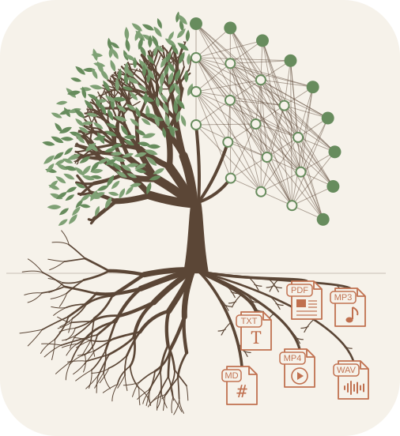
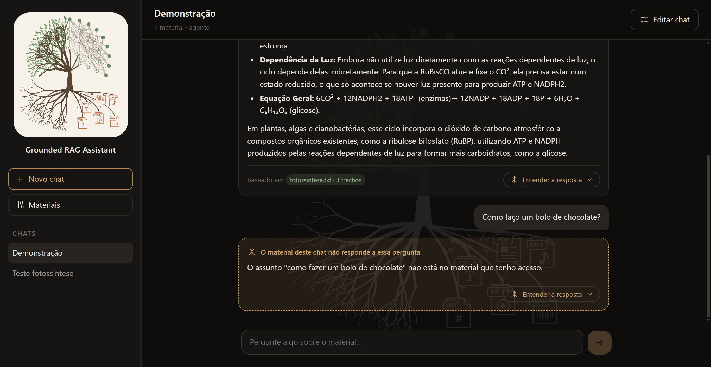
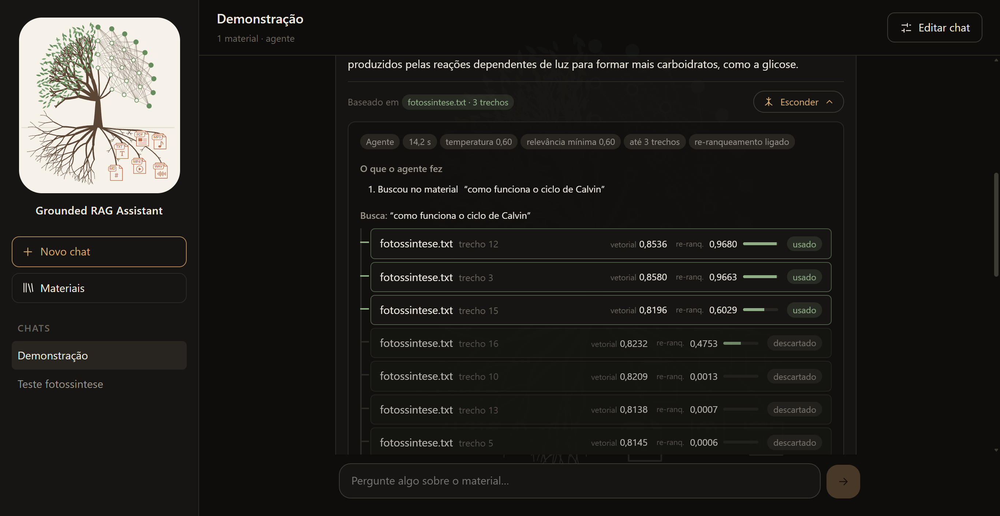
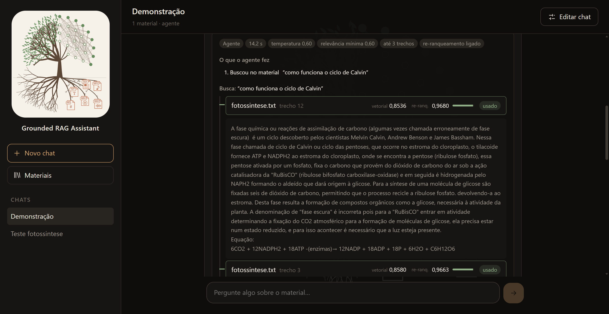

<p align="center">
  
</p>

<h1 align="center">Grounded RAG Assistant</h1>

Assistente de inteligência artificial que responde **apenas com base no material que o usuário fornece** — documentos, PDFs, áudios e vídeos. Quando a resposta não está no material, ele avisa em vez de inventar, e cada resposta mostra de quais trechos veio.

Tudo roda na sua máquina: os modelos de transcrição, busca, re-ranqueamento e o modelo de linguagem são locais e abertos. Nenhum conteúdo sai do computador e não há custo por uso.

## Como funciona

- **Ingestão multimídia** — texto, PDF, áudio e vídeo (com transcrição automática pelo Whisper).
- **Busca em dois estágios** — busca vetorial (`multilingual-e5-large`) seguida de re-ranqueamento (`bge-reranker-v2-m3`), que dá uma nota de relevância confiável a cada trecho.
- **Recusa** — se nenhum trecho atinge a relevância mínima, o assistente diz que o material não responde.
- **Agente** — o modelo de linguagem (`qwen3.5:4b`, via Ollama) escolhe como consultar o material: buscar, listar os assuntos, resumir ou pedir esclarecimento. Ele só tem ferramentas que leem o material do chat.
- **Chats** — cada chat usa os materiais escolhidos da biblioteca e tem seus próprios parâmetros.

## Como usar

1. Em **Materiais**, envie os arquivos (clique ou arraste). O processamento aparece na lista e termina sozinho.
2. Em **Novo chat**, dê um nome, escolha os materiais e, se quiser, ajuste os parâmetros.
3. Pergunte. Em cada resposta, **Entender a resposta** mostra o que o agente fez, cada trecho encontrado com o material de origem e as notas da busca e do re-ranqueamento, quais trechos foram usados e as duas versões da resposta.

## Telas

**Conversa.** Cada resposta mostra de quais materiais veio. Quando o material não responde, a recusa aparece com visual próprio.



**Entender a resposta.** O painel mostra o que o agente fez e cada trecho encontrado, com a nota da busca e a do re-ranqueamento, e se o trecho foi usado ou descartado.



**Trecho aberto.** Ao clicar num trecho, ele se expande e mostra o texto completo que sustentou a resposta.



## Rodar na sua máquina

### Requisitos

| | Mínimo |
|---|---|
| Programa | [Docker Desktop](https://www.docker.com/products/docker-desktop/) |
| Memória para o Docker | 8 GB (o padrão do Docker Desktop numa máquina com 16 GB) |
| Disco | ~15 GB (imagens + modelos) |
| Internet | só na primeira execução, para baixar os modelos |
| Placa de vídeo | opcional — com uma NVIDIA as respostas ficam ~6 vezes mais rápidas |

### Passo a passo

1. Instale e abra o Docker Desktop.
2. Baixe o projeto:

   ```bash
   git clone https://github.com/kevin-sachetti/grounded-rag-course-assistant.git
   cd grounded-rag-course-assistant
   ```

3. Suba tudo:

   ```bash
   docker compose up -d --build
   ```

4. Abra **http://localhost:8080**.

Para parar: `docker compose down`. Os materiais e as conversas ficam salvos.

Com placa de vídeo NVIDIA (driver atualizado e Docker Desktop no modo WSL 2), suba com o arquivo extra:

```bash
docker compose -f docker-compose.yml -f docker-compose.gpu.yml up -d --build
```

### Primeira execução

A primeira execução demora: são baixados o modelo de linguagem (~3,3 GB) ao subir e os modelos de busca (~4,5 GB) no primeiro material enviado. Tudo fica guardado e as próximas execuções são rápidas, inclusive sem internet.

### Tempo de resposta medido

| | Com placa (RTX 3060) | Só processador (8 GB para o Docker) |
|---|---|---|
| Pergunta ao agente | 7 a 18 s | 35 a 40 s |
| Primeira pergunta depois de subir | ~30 s | ~90 s (carrega os modelos) |

## Estado atual

| Parte | Situação |
|---|---|
| Biblioteca de materiais, chats e mensagens (API) | ✅ testado |
| Ingestão de texto | ✅ testado |
| Ingestão de PDF, áudio e vídeo | ✅ testado com 8 arquivos reais (4 PDFs, 2 áudios e 2 vídeos) — ver [experimentos](docs/experimentos.md#testes-com-8-materiais-reais) |
| Busca em dois estágios e recusa por relevância | ✅ testado e medido — ver [experimentos](docs/experimentos.md) |
| Agente com modelo local (Qwen3.5 4B) | ✅ testado, com histórico da conversa: 16 de 16 perguntas com o resultado esperado |
| Interface: biblioteca de materiais, chats, conversa e painel "entender a resposta" | ✅ testada no navegador, no computador e no celular |

A API também pode ser usada direto pela documentação interativa em http://localhost:8000/docs.

## Stack

| Camada | Tecnologia |
|---|---|
| Backend | Python 3.14, FastAPI, LangChain, LangGraph |
| Banco | PostgreSQL 17 + pgvector |
| Embeddings | `intfloat/multilingual-e5-large` |
| Re-ranqueamento | `BAAI/bge-reranker-v2-m3` |
| Transcrição | Whisper (`base`) |
| Modelo de linguagem | `qwen3.5:4b` via Ollama (OpenAI e Anthropic seguem como opção) |
| Frontend | Vue 3, TypeScript, Vite, Pinia, servido pelo nginx |
| Infraestrutura | Docker Compose |

## Configuração

Os valores padrão estão em `backend/app/infra/config.py` e podem ser trocados num arquivo `backend/.env`, com o nome em maiúsculas. Depois de alterar, recrie os contêineres com `docker compose up -d`.

| Variável | Padrão | O que controla |
|---|---|---|
| `LLM_MODEL` | `qwen3.5:4b` | Modelo de linguagem (baixado automaticamente) |
| `LLM_PROVIDER` | `ollama` | `ollama`, `openai` ou `anthropic` |
| `USE_LLM_REFORMULATION` | `true` | Com o agente desligado, reescreve a resposta com o modelo (`false` devolve os trechos crus) |
| `RETRIEVAL_CANDIDATES` | `7` | Candidatos do primeiro estágio da busca |
| `CHAT_HISTORY_MESSAGES` | `6` | Mensagens anteriores que o agente recebe |
| `CHUNK_SIZE` / `CHUNK_OVERLAP` | `1400` / `200` | Tamanho dos trechos, em caracteres |
| `WHISPER_MODEL_SIZE` | `base` | Tamanho do modelo de transcrição |
| `MAX_UPLOAD_MB` | `1024` | Tamanho máximo de um arquivo enviado |

Temperatura, relevância mínima, trechos por resposta, re-ranqueamento e agente são ajustados **por chat**.

## Documentação

| Documento | Conteúdo |
|---|---|
| [Arquitetura](docs/arquitetura.md) | Partes do sistema, fluxos de ingestão e de resposta, garantias e modelo de dados |
| [API](docs/api.md) | Rotas, formatos de entrada e saída e erros |
| [Decisões técnicas](docs/decisoes.md) | Cada escolha, as alternativas avaliadas e o motivo |
| [Experimentos](docs/experimentos.md) | O que foi medido e testado, com os números |

## Estrutura

```
├── backend/
│   ├── app/
│   │   ├── main.py            cria a API e registra as rotas
│   │   ├── features/          materiais e chats (rotas e regras)
│   │   ├── pipeline/          ingestão, busca, fluxo fixo e agente
│   │   ├── adapters/          armazenamento, embeddings, banco vetorial, re-ranqueador, LLM
│   │   └── infra/             configuração, banco e logs
│   ├── Dockerfile             imagem da API (Python, PyTorch para CPU e FFmpeg)
│   └── pyproject.toml         dependências do backend
├── frontend/
│   ├── src/
│   │   ├── components/        telas e partes da interface
│   │   ├── stores/            estado compartilhado (Pinia)
│   │   ├── api/               chamadas à API
│   │   ├── styles/            cores e estilos
│   │   ├── utils/             formatação
│   │   └── assets/            ícone, árvore e folhas
│   ├── Dockerfile             build com o Vite e entrega pelo nginx
│   ├── nginx.conf             serve a interface e repassa /api para a API
│   └── package.json           dependências do frontend
├── contents/                  material usado nos testes
├── docker/postgres/           script que habilita o pgvector
├── docs/                      arquitetura, API, decisões técnicas e experimentos
├── data/                      arquivos enviados (criada ao rodar, fica fora do Git)
├── docker-compose.yml         sobe banco, modelo de linguagem, API e interface
├── docker-compose.gpu.yml     usa a placa NVIDIA, se houver
├── LICENSE                    todos os direitos reservados
└── README.md
```

O detalhe de cada arquivo do backend e do frontend está em [docs/arquitetura.md](docs/arquitetura.md).

## Licença

© 2026 Kevin Sachetti Correa. Todos os direitos reservados. O código está disponível para consulta e avaliação acadêmica; cópia, modificação, distribuição ou uso, no todo ou em parte, dependem de autorização por escrito do autor. Ver [LICENSE](LICENSE).

## Autor

**Kevin Sachetti Correa**

- LinkedIn: [kevin-sachetti-correa](https://www.linkedin.com/in/kevin-sachetti-correa/)
- GitHub: [kevin-sachetti](https://github.com/kevin-sachetti)
- E-mail: kev.sachetti@gmail.com
- Telefone: +55 51 98029-6088
