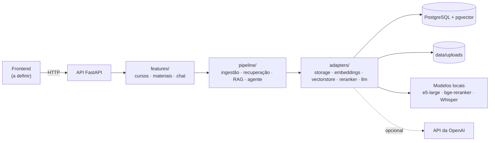
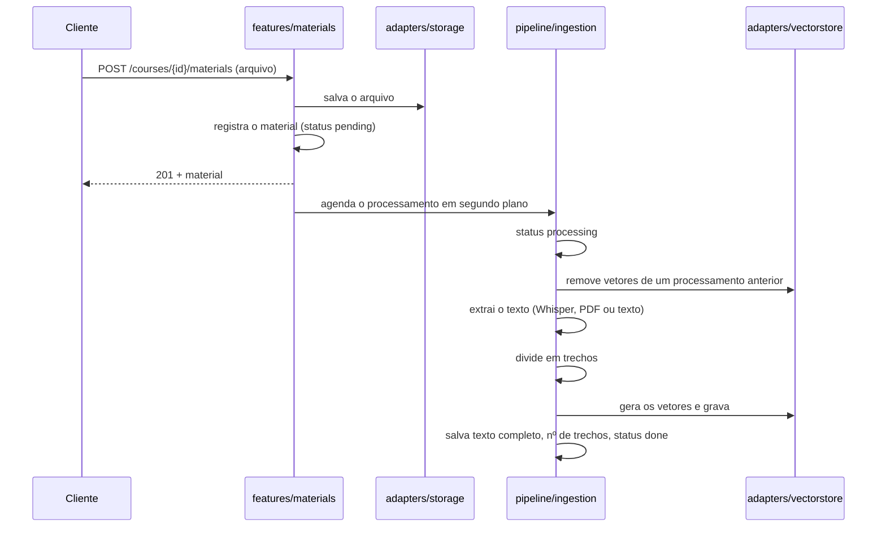
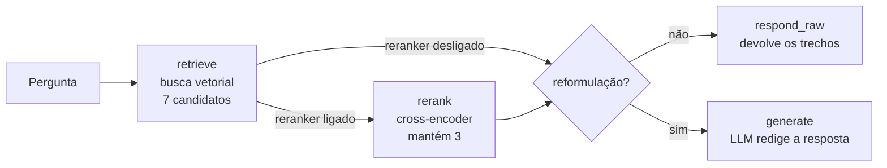

# Arquitetura

## Visão geral

O backend é uma API FastAPI organizada em quatro camadas. As rotas recebem as requisições, o pipeline executa o processamento de IA e os adapters isolam tudo o que é externo ou trocável: armazenamento de arquivos, modelos e banco vetorial.



## Camadas

| Camada | Responsabilidade | Conhece |
|---|---|---|
| `features/` | Rotas HTTP, validação de entrada e saída, regras de negócio de cada funcionalidade | pipeline, adapters, infra |
| `pipeline/` | Processamento de IA: ingestão, recuperação, pipeline RAG e agente | modelos de dados das features, adapters, infra |
| `adapters/` | Integrações trocáveis, cada uma atrás de uma interface simples | infra |
| `infra/` | Configuração, conexão com o banco e logging | — |

O pipeline usa os **modelos de dados** das features (por exemplo, `Material`), mas nunca as rotas.

## Estrutura de pastas

```
backend/app/
├── main.py                      cria a API, registra rotas, CORS e /health
├── infra/
│   ├── config.py                todas as configurações (sobrescrevíveis por variável de ambiente)
│   ├── db.py                    engine assíncrono, sessões e classe base dos modelos
│   └── logging.py
├── features/
│   ├── courses/                 models · schemas · service · router
│   ├── materials/               models · schemas · service · router
│   └── chat/                    schemas · service · router
├── pipeline/
│   ├── ingestion/
│   │   ├── transcriber.py       Whisper
│   │   ├── loader.py            extrai o texto conforme o tipo do material
│   │   ├── splitter.py          divide o texto em trechos
│   │   └── service.py           orquestra a ingestão de ponta a ponta
│   ├── retrieval.py             recuperação em dois estágios (compartilhada)
│   ├── rag/                     pipeline fixo: state · nodes · graph · prompts
│   └── agent/                   agente: tools · graph · prompts
└── adapters/
    ├── storage/                 base · local · factory
    ├── embeddings/              huggingface
    ├── vectorstore/             pgvector
    ├── reranker/                bge
    └── llm/                     providers
```

Os arquivos `__init__.py` existem só dentro de `adapters/`, onde reexportam as funções públicas. Isso permite escrever `from app.adapters.vectorstore import search` e trocar a implementação sem mexer em quem importa.

---

## Fluxo 1 — Ingestão de material



Pontos importantes:

- **O cliente não espera o processamento.** A resposta sai com `pending`, e o status é consultado depois em `GET /materials/{id}`.
- **Transcrição e divisão rodam em uma thread separada** (`asyncio.to_thread`). Transcrever um vídeo leva minutos de CPU; se rodasse no laço de eventos, a API inteira pararia de responder durante esse tempo.
- **Os trechos recebem ids determinísticos**, derivados do id do material (`uuid5(material_id, índice)`). Guardando só a quantidade de trechos (`chunk_count`), é possível recalcular os ids e apagar os vetores quando o material é excluído ou reprocessado.
- **O texto completo fica salvo** na tabela `materials`. Os trechos ficam no índice, mas a ferramenta de resumo do agente precisa do material inteiro.
- **O prefixo `passage: `** é adicionado a cada trecho antes de gerar o vetor, porque o modelo e5 foi treinado assim.

## Fluxo 2 — Pipeline de resposta (modo padrão)

Usado quando `USE_AGENT=false`. O caminho é fixo e definido no código.



1. **`retrieve`** — vetoriza a pergunta com o prefixo `query: ` e busca no pgvector os trechos mais parecidos, **filtrando pelo curso**. Traz `RETRIEVAL_CANDIDATES` trechos.
2. **`rerank`** — o cross-encoder lê a pergunta e cada trecho **juntos** e dá uma nota de relevância de 0 a 1. Ficam os `RETRIEVAL_K` melhores. Roda em thread separada.
3. **`respond_raw`** — devolve os trechos como estão, sem LLM.
4. **`generate`** — uma chamada ao LLM, com instruções para usar apenas os trechos.

A busca vetorial é rápida mas pouco precisa; o cross-encoder é preciso mas lento. Por isso a busca vetorial varre o material e o cross-encoder só reordena os candidatos. A necessidade desse segundo estágio foi medida — ver [experimentos](experimentos.md).

## Fluxo 3 — Agente

Usado quando `USE_AGENT=true`. O modelo decide o caminho a cada pergunta.


O agente pode chamar várias ferramentas, uma ou mais vezes, até decidir que já tem o que precisa. O limite é de `AGENT_MAX_STEPS` passos.

| Ferramenta | O que faz | Fonte |
|---|---|---|
| `buscar_no_material(pergunta)` | Recuperação em dois estágios; devolve só trechos com relevância ≥ `SIMILARITY_THRESHOLD` | Trechos do curso |
| `listar_topicos()` | Lista os materiais do curso com o início de cada um | Materiais do curso |
| `resumir_material(nome)` | Devolve o texto completo de um material, limitado a 12.000 caracteres | Texto do material |
| `pedir_esclarecimento(pergunta)` | Devolve uma pergunta ao aluno quando a dúvida é ambígua | Nenhuma |

Pontos importantes:

- **O `course_id` não é parâmetro de nenhuma ferramenta.** Ele é fixado quando as ferramentas são montadas. O modelo não tem como pedir material de outro curso, porque essa opção não existe na interface dele.
- **O grafo é montado a cada requisição**, com um coletor de fontes próprio. Uma requisição nunca enxerga as fontes de outra. Montar o grafo é barato: os modelos pesados ficam em cache separado.
- **O agente tem autonomia de estratégia, não de fonte.** Ele decide como procurar, mas todas as ferramentas leem apenas o material do curso.

---

## Garantias de isolamento e fidelidade

| Garantia | Como é implementada | Tipo |
|---|---|---|
| Uma pergunta só consulta o material do próprio curso | Filtro por `course_id` na busca vetorial | Estrutural |
| O agente não acessa outro curso | `course_id` fixado na montagem das ferramentas | Estrutural |
| Nenhuma resposta usa fonte externa | Nenhuma ferramenta tem acesso fora do material | Estrutural |
| Material ou curso excluído deixa de ser consultado | Exclusão remove os vetores do índice | Estrutural |
| O modelo não responde por conhecimento próprio | Instruções nos prompts | **Comportamental** — depende do modelo obedecer |

As garantias estruturais valem independentemente do comportamento do LLM. A última é um reforço, não uma garantia. No modo extrativo padrão ela nem se aplica, porque não há LLM.

---

## Adapters

Cada adapter isola uma dependência externa. Trocar a implementação não afeta o resto do sistema.

| Adapter | Interface | Implementação atual | Para trocar |
|---|---|---|---|
| `storage` | `save`, `full_path`, `delete` | Disco local (`data/uploads`) | Nova classe de `Storage` (ex.: S3) e ajuste em `factory.py` |
| `embeddings` | `get_embeddings()` | e5-large com prefixos `query:` / `passage:` | `EMBEDDING_MODEL_NAME` e prefixos — exige reprocessar os materiais |
| `vectorstore` | `add_chunks`, `delete_chunks`, `search` | pgvector via LangChain | Nova implementação das três funções |
| `reranker` | `rerank(pergunta, docs, top_k)` | bge-reranker-v2-m3 | `RERANKER_MODEL_NAME` |
| `llm` | `get_llm()` | OpenAI ou Anthropic | `LLM_PROVIDER` e `LLM_MODEL` |

O adapter de re-ranqueamento normaliza as notas para 0–1 aplicando sigmoide apenas quando o modelo devolve valores fora dessa faixa, para não aplicar a função duas vezes.

---

## Modelo de dados

### `courses`

| Coluna | Tipo |
|---|---|
| `id` | UUID, chave primária |
| `name` | texto (até 200), indexado |
| `description` | texto, opcional |
| `created_at`, `updated_at` | data e hora com fuso |

### `materials`

| Coluna | Tipo | Observação |
|---|---|---|
| `id` | UUID, chave primária | |
| `course_id` | UUID, chave estrangeira | `ON DELETE CASCADE` |
| `filename` | texto | |
| `content_type` | texto, opcional | |
| `media_type` | texto | `audio`, `video`, `pdf`, `text` ou `other` |
| `storage_key` | texto | Caminho do arquivo no storage |
| `text` | texto, opcional | Texto completo extraído |
| `chunk_count` | inteiro | Quantidade de trechos gerados |
| `status` | texto | `pending`, `processing`, `done` ou `error` |
| `created_at`, `updated_at` | data e hora com fuso | |

### Índice vetorial

Tabelas gerenciadas pelo LangChain: `langchain_pg_collection` e `langchain_pg_embedding`. Todos os trechos ficam na coleção `material_chunks`, cada um com:

- `id` — determinístico, `uuid5(material_id, índice)`;
- vetor de 1024 dimensões;
- metadados `course_id`, `material_id` e `chunk_index`.

---

## Infraestrutura

Dois serviços no `docker-compose.yml`:

| Serviço | Imagem | Porta | Volumes |
|---|---|---|---|
| `db` | `pgvector/pgvector:pg17` | 5432 | `pgdata` (dados), `docker/postgres/init.sql` (habilita o pgvector) |
| `api` | construída de `backend/` | 8000 | `./backend` (código, com recarga automática), `./data` (uploads), `modelcache` (modelos) |

Os motivos de cada escolha de ambiente estão em [decisoes.md](decisoes.md#d14--infraestrutura).

---

## Limitações conhecidas

| Limitação | Consequência |
|---|---|
| Tabelas criadas com `create_all` na subida, sem migrações | Qualquer mudança de schema exige recriar as tabelas e perder os dados |
| Upload sem validação de tamanho e tipo, e lido inteiro na memória | Um arquivo muito grande pode esgotar a memória da API |
| Processamento em segundo plano não é persistente | Se a API reiniciar no meio, o material fica parado em `processing` |
| Sem autenticação | Qualquer cliente acessa todos os cursos |
| `SIMILARITY_THRESHOLD` só é aplicado no agente | No pipeline, trechos pouco relevantes também chegam à resposta |
| Frontend não definido | O sistema hoje só é usado pela API |
