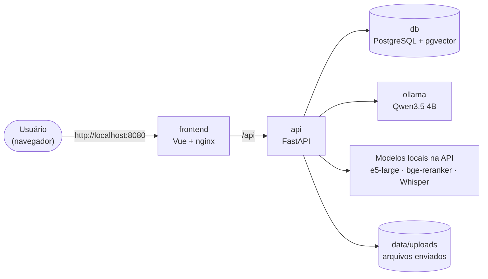
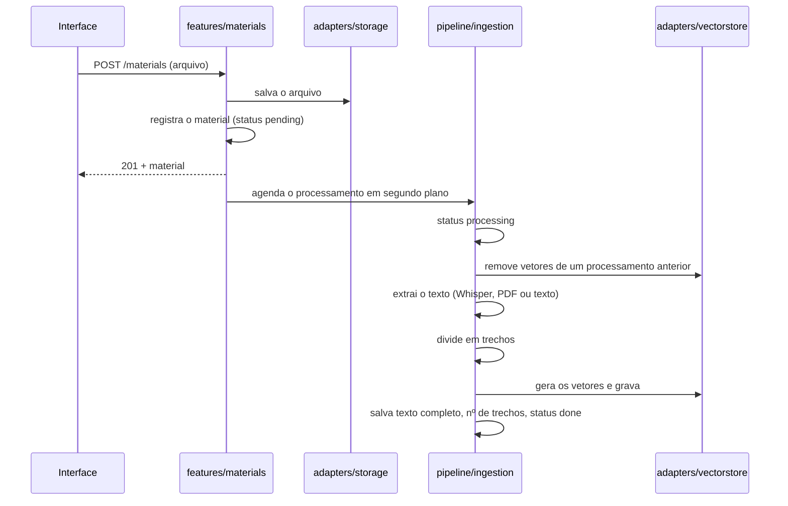
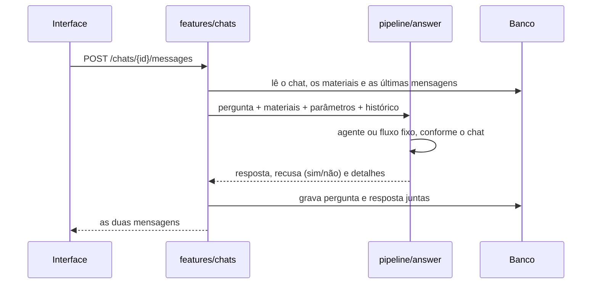
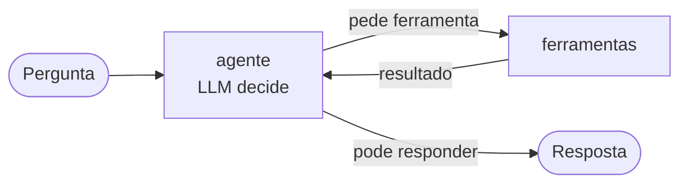
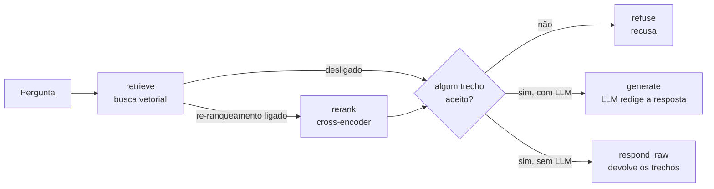

# Arquitetura

## Visão geral

O sistema tem quatro partes, cada uma em um contêiner do Docker: a interface, a API, o modelo de linguagem e o banco de dados. O usuário só acessa a interface; ela repassa os pedidos à API, que faz todo o processamento.



Nenhuma parte depende de serviço externo depois que os modelos são baixados. OpenAI e Anthropic continuam disponíveis como opção de modelo de linguagem, por configuração.

## Conceitos

| Conceito | O que é |
|---|---|
| **Material** | Um arquivo enviado pelo usuário (texto, PDF, áudio ou vídeo). Fica numa biblioteca única e pode ser usado por vários chats. |
| **Chat** | Um assistente criado pelo usuário, com nome, materiais escolhidos da biblioteca e parâmetros próprios. Só responde com os materiais dele. |
| **Mensagem** | Pergunta ou resposta de um chat. A resposta guarda o processamento completo, que alimenta o painel "entender a resposta". |
| **Trecho** | Pedaço do texto de um material, com até 1.400 caracteres, transformado em vetor para a busca. |

## Backend em camadas

| Camada | Responsabilidade | Conhece |
|---|---|---|
| `features/` | Rotas HTTP, validação de entrada e saída e regras de cada funcionalidade | pipeline, adapters, infra |
| `pipeline/` | Processamento de IA: ingestão, busca, fluxo fixo e agente | modelos de dados das features, adapters, infra |
| `adapters/` | Integrações trocáveis, cada uma atrás de uma interface simples | infra |
| `infra/` | Configuração, conexão com o banco e logs | — |

O pipeline usa os **modelos de dados** das features (por exemplo, `Material`), mas nunca as rotas.

```
backend/app/
├── main.py                      cria a API, registra as rotas, CORS e /health
├── infra/
│   ├── config.py                todas as configurações (trocáveis por variável de ambiente)
│   ├── db.py                    conexão assíncrona, sessões e classe base dos modelos
│   └── logging.py
├── features/
│   ├── materials/               biblioteca de materiais: models · schemas · service · router
│   └── chats/                   chats e mensagens: models · schemas · service · router
├── pipeline/
│   ├── ingestion/
│   │   ├── transcriber.py       Whisper
│   │   ├── loader.py            extrai o texto conforme o tipo do material
│   │   ├── splitter.py          divide o texto em trechos
│   │   └── service.py           orquestra a ingestão de ponta a ponta
│   ├── params.py                parâmetros de um chat que influenciam a resposta
│   ├── retrieval.py             busca em dois estágios (compartilhada)
│   ├── answer.py                escolhe o modo (fixo ou agente) e monta os detalhes da resposta
│   ├── rag/                     fluxo fixo: state · nodes · graph · prompts
│   └── agent/                   agente: tools · graph · prompts
└── adapters/
    ├── storage/                 base · local · factory
    ├── embeddings/              huggingface (e5-large)
    ├── vectorstore/             pgvector
    ├── reranker/                bge
    └── llm/                     providers (ollama · openai · anthropic)
```

Os arquivos `__init__.py` existem só dentro de `adapters/`, onde reexportam as funções públicas. Assim, `from app.adapters.vectorstore import search` continua igual mesmo que a implementação mude.

## Frontend

Aplicação Vue 3 com TypeScript, preparada pelo Vite e servida pelo nginx.

```
frontend/src/
├── main.ts · App.vue            entrada e layout (menu lateral + conversa)
├── api/                         client.ts (chamadas à API) · types.ts (formatos)
├── stores/                      estado compartilhado com Pinia: materials · chats · messages · ui
├── components/
│   ├── AppSidebar.vue           menu: Materiais, Novo chat e lista de chats
│   ├── MaterialsModal.vue       biblioteca: enviar, acompanhar e excluir materiais
│   ├── ChatFormModal.vue        criar e editar chat (nome, materiais e parâmetros)
│   ├── ChatArea.vue             conversa
│   ├── MessageItem.vue          uma mensagem, com visual próprio para a recusa
│   ├── AnswerDetails.vue        painel "entender a resposta"
│   ├── RootLoader.vue           animação de raízes enquanto a resposta é gerada
│   └── AppFooter.vue · BaseModal.vue · AppIcon.vue
├── styles/                      theme.css (cores e medidas) · base.css
├── utils/format.ts
└── assets/                      ícone, árvore de fundo e folhas do rodapé
```

O nginx serve os arquivos da interface e repassa tudo o que começa com `/api` para a API. Por isso o usuário acessa um único endereço, e o navegador não precisa de CORS.

---

## Fluxo 1 — Ingestão de material



- **A interface não espera o processamento.** A resposta sai com `pending`, e a lista de materiais se atualiza sozinha até o status mudar.
- **O progresso é real.** Cada etapa informa quanto já fez: a transcrição pelo avanço do Whisper no áudio, o PDF por página e os vetores por lote de trechos. A API devolve a etapa e o percentual junto com o material, e a interface mostra uma barra. Esse progresso fica na memória da API, porque o processamento também roda nela.
- **O envio é validado antes de gravar:** formato, tamanho (até 1 GB), arquivo vazio e nome repetido. O nome do arquivo perde qualquer pasta, para não gravar fora da pasta de envios.
- **Transcrição e divisão rodam em uma thread separada** (`asyncio.to_thread`). Sem isso, a API inteira pararia de responder enquanto um vídeo é transcrito.
- **Os trechos recebem ids determinísticos**, derivados do id do material (`uuid5(material_id, índice)`). Guardando só a quantidade de trechos, é possível recalcular os ids e apagar os vetores quando o material é excluído ou reprocessado.
- **O texto completo fica salvo** na tabela `materials`, porque a ferramenta de resumo do agente precisa do material inteiro.
- **O prefixo `passage: `** é acrescentado a cada trecho antes de gerar o vetor, como o modelo e5 exige.

## Fluxo 2 — Pergunta em um chat



A pergunta e a resposta só são gravadas depois que a resposta fica pronta. Se a geração falhar (por exemplo, com o Ollama fora do ar), a API responde `502` e a conversa não fica com uma pergunta sem resposta.

### Busca em dois estágios

Usada pelos dois modos.

1. **Busca vetorial** — vetoriza a pergunta com o prefixo `query: ` e traz os `RETRIEVAL_CANDIDATES` (7) trechos mais parecidos, **só dos materiais do chat**.
2. **Re-ranqueamento** — o cross-encoder lê a pergunta e cada trecho juntos e dá uma nota de 0 a 1. Pode ser desligado por chat.
3. **Seleção** — ficam os `retrieval_k` melhores que atingem a relevância mínima do chat. Se nenhum atinge, nenhum é usado, e isso leva à recusa.

Todos os candidatos são guardados com as notas, inclusive os descartados, para o painel mostrar o que foi usado e por quê.

### Modo agente (padrão)



O modelo recebe a pergunta, as últimas `CHAT_HISTORY_MESSAGES` (6) mensagens do chat e a descrição das ferramentas. Ele pode chamar ferramentas várias vezes até ter o necessário, com limite de `AGENT_MAX_STEPS` (12) passos.

| Ferramenta | O que faz | Fonte |
|---|---|---|
| `buscar_no_material(pergunta)` | Busca em dois estágios; devolve só os trechos aceitos, ou o aviso de que nada relevante foi encontrado | Trechos dos materiais do chat |
| `listar_topicos()` | Lista os materiais do chat com o início de cada um | Materiais do chat |
| `resumir_material(nome)` | Devolve o texto completo de um material, limitado a 12.000 caracteres | Texto do material |
| `pedir_esclarecimento(pergunta)` | Devolve uma pergunta ao usuário quando a dele não tem assunto identificável | Nenhuma |

No código, cada ferramenta é uma função marcada com `@tool` do LangChain. O grafo do LangGraph tem dois nós, o modelo e o `ToolNode`, ligados pelo `tools_condition`, que decide entre executar uma ferramenta ou terminar.

A resposta é marcada como **recusa** quando o agente só fez buscas e nenhuma trouxe trecho aceito.

### Modo fixo

Usado quando o agente está desligado no chat. O caminho é sempre o mesmo:



`USE_LLM_REFORMULATION` define se a resposta é redigida pelo LLM ou se são devolvidos os trechos como estão.

### Detalhes da resposta

Cada resposta guarda, em `details`, o que o painel "entender a resposta" mostra:

| Campo | Conteúdo |
|---|---|
| `mode` | `agent` ou `fixed` |
| `params` | Parâmetros usados: temperatura, relevância mínima, trechos por resposta, re-ranqueamento |
| `steps` | Ferramentas chamadas pelo agente, em ordem, com a entrada de cada uma |
| `searches` | Cada busca, com todos os candidatos: material, posição, texto, nota vetorial, nota do re-ranqueamento e se foi usado |
| `versions` | A resposta final e a versão extrativa, formada só pelos trechos usados |
| `history_messages` | Quantas mensagens anteriores o agente recebeu |
| `elapsed_seconds` | Tempo de processamento |

---

## Garantias de isolamento e fidelidade

| Garantia | Como é implementada | Tipo |
|---|---|---|
| Uma pergunta só consulta os materiais do próprio chat | Filtro pelos materiais do chat na busca vetorial | Estrutural |
| O agente não acessa material de fora do chat | Lista de materiais fixada na montagem das ferramentas, fora do alcance do modelo | Estrutural |
| Nenhuma resposta usa fonte externa | Nenhuma ferramenta acessa algo além dos materiais | Estrutural |
| Material excluído deixa de ser consultado | A exclusão remove os vetores, o arquivo e a ligação com os chats | Estrutural |
| Trecho pouco relevante não sustenta a resposta | Relevância mínima do chat, nos dois modos; sem trecho aceito, há recusa | Estrutural |
| O modelo não responde por conhecimento próprio | Instruções do agente e do fluxo fixo | **Comportamental**, depende de o modelo obedecer |

As garantias estruturais valem independentemente do comportamento do LLM. A última é um reforço.

---

## Adapters

| Adapter | Interface | Implementação atual | Para trocar |
|---|---|---|---|
| `storage` | `save`, `full_path`, `delete` | Disco local (`data/uploads`) | Nova classe de `Storage` e ajuste em `factory.py` |
| `embeddings` | `get_embeddings()` | multilingual-e5-large, com prefixos `query: ` e `passage: ` | `EMBEDDING_MODEL_NAME` e prefixos; exige reprocessar os materiais |
| `vectorstore` | `add_chunks`, `delete_chunks`, `search` | pgvector via LangChain, com filtro pelos materiais | Nova implementação das três funções |
| `reranker` | `score(pergunta, textos)` | bge-reranker-v2-m3, via Sentence Transformers | `RERANKER_MODEL_NAME` |
| `llm` | `get_llm(temperatura)` | Qwen3.5 4B via Ollama | `LLM_PROVIDER` (`ollama`, `openai`, `anthropic`) e `LLM_MODEL` |

O adapter de re-ranqueamento converte as notas para 0 a 1 com a sigmoide apenas quando o modelo devolve valores fora dessa faixa, para não aplicar a função duas vezes.

---

## Modelo de dados

### `materials`

| Coluna | Tipo | Observação |
|---|---|---|
| `id` | UUID, chave primária | |
| `filename` | texto | |
| `content_type` | texto, opcional | |
| `media_type` | texto | `audio`, `video`, `pdf`, `text` ou `other` |
| `storage_key` | texto | Caminho do arquivo no storage |
| `text` | texto, opcional | Texto completo extraído |
| `chunk_count` | inteiro | Quantidade de trechos gerados |
| `status` | texto | `pending`, `processing`, `done` ou `error` |
| `created_at`, `updated_at` | data e hora com fuso | |

### `chats`

| Coluna | Tipo | Padrão |
|---|---|---|
| `id` | UUID, chave primária | |
| `name` | texto (até 200) | |
| `temperature` | número | 0,6 |
| `similarity_threshold` | número de 0 a 1 | 0,6 |
| `retrieval_k` | inteiro | 3 |
| `use_reranker` | booleano | ligado |
| `use_agent` | booleano | ligado |
| `created_at`, `updated_at` | data e hora com fuso | |

### `chat_materials`

Ligação muitos-para-muitos entre chats e materiais (`chat_id`, `material_id`). Excluir um chat ou um material remove só a ligação; o outro lado continua existindo.

### `messages`

| Coluna | Tipo | Observação |
|---|---|---|
| `id` | UUID, chave primária | |
| `chat_id` | UUID, chave estrangeira | `ON DELETE CASCADE` |
| `role` | texto | `user` ou `assistant` |
| `content` | texto | |
| `refused` | booleano | A resposta foi uma recusa |
| `details` | JSONB, opcional | Processamento da resposta (ver acima) |
| `created_at` | data e hora com fuso | |

### Índice vetorial

Tabelas gerenciadas pelo LangChain: `langchain_pg_collection` e `langchain_pg_embedding`. Cada trecho tem o id determinístico, o vetor de 1.024 dimensões, o texto e os metadados `material_id` e `chunk_index`.

---

## Infraestrutura

| Serviço | Imagem | Porta publicada | Volumes |
|---|---|---|---|
| `db` | `pgvector/pgvector:pg17` | nenhuma | `pgdata`, `docker/postgres/init.sql` (habilita o pgvector) |
| `ollama` | `ollama/ollama:0.34.2` | nenhuma | `ollamadata` (modelo de linguagem) |
| `ollama-init` | `ollama/ollama:0.34.2` | — | Baixa o modelo na primeira subida e encerra |
| `api` | construída de `backend/` | 8000 (documentação em `/docs`) | `./backend` (código, com recarga automática), `./data` (arquivos enviados), `modelcache` (modelos de busca e transcrição) |
| `frontend` | construída de `frontend/` (Node para o build, nginx para servir) | 8080 | — |

O banco e o Ollama não publicam porta: só a API fala com eles, pela rede interna do Docker. Assim não há conflito com um PostgreSQL ou Ollama que já exista na máquina.

Com placa NVIDIA, o arquivo `docker-compose.gpu.yml` reserva a placa para o Ollama. Os motivos de cada escolha de ambiente estão em [decisoes.md](decisoes.md#d14--infraestrutura).

---

## Limitações conhecidas

| Limitação | Consequência |
|---|---|
| Tabelas criadas com `create_all` na subida, sem migrações | Uma mudança de schema exige recriar as tabelas e perder os dados |
| Upload lido inteiro na memória antes de ser gravado, até o limite de 1 GB | Um arquivo perto do limite ocupa essa memória na API enquanto é recebido |
| Processamento em segundo plano não é persistente | Se a API reiniciar no meio, o material fica parado em `processing` |
| Sem autenticação | Feito para uso local, por uma pessoa; qualquer um com acesso ao endereço vê tudo |
| A recusa do agente depende de ele buscar antes de responder | As instruções exigem a busca, mas é uma regra comportamental |
